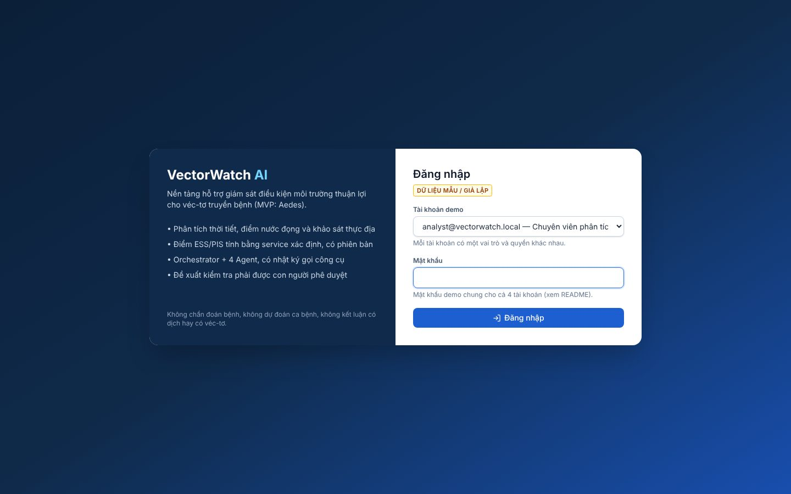
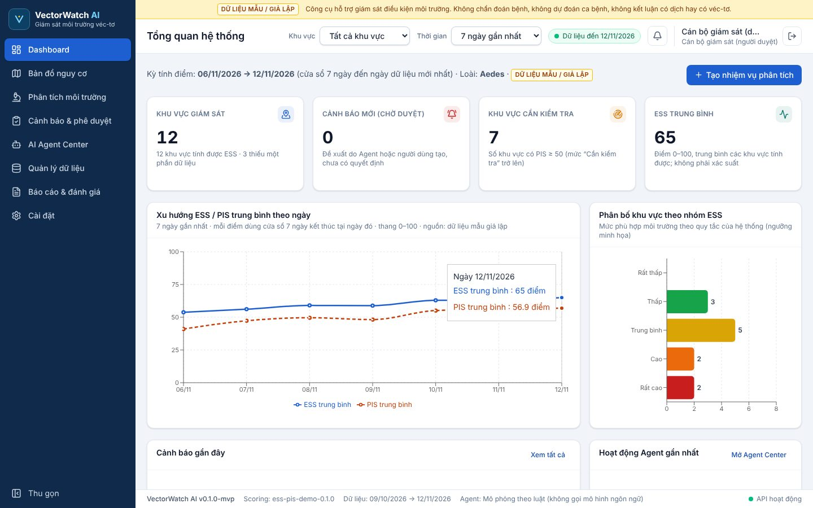
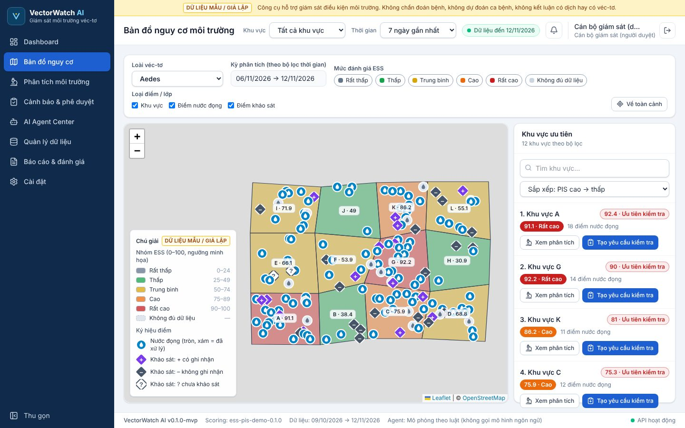
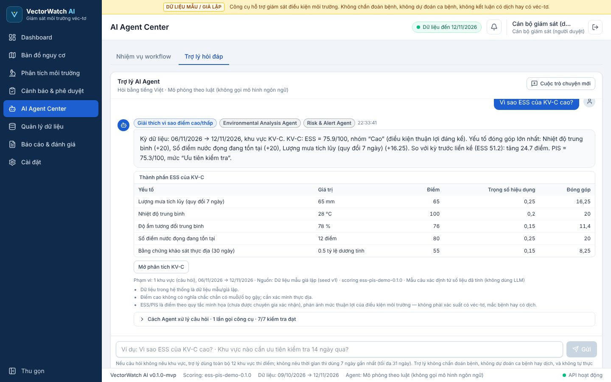
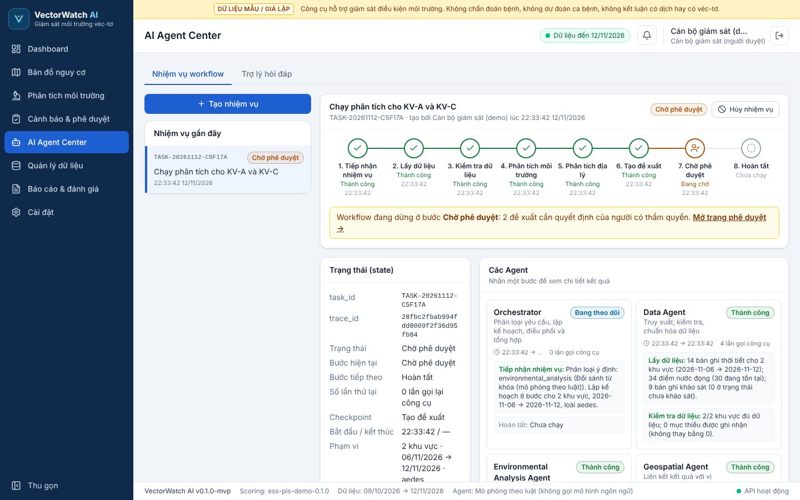
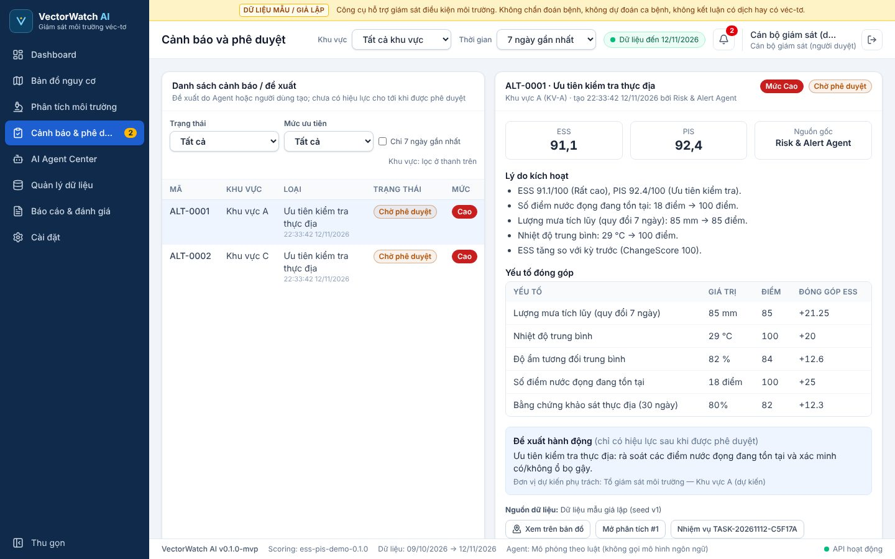
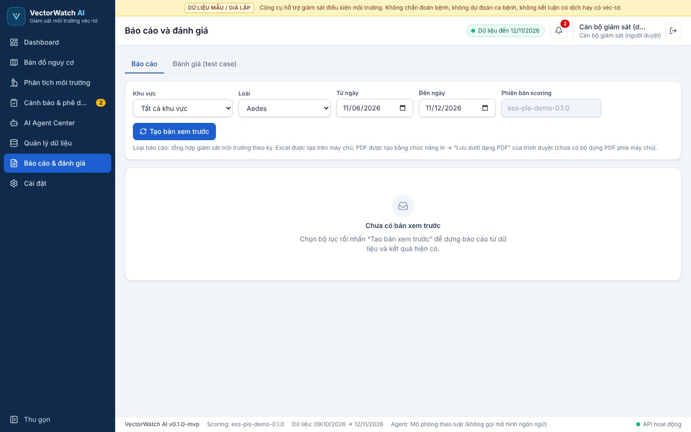

# VectorWatch AI — MVP

Nền tảng hỗ trợ **giám sát điều kiện môi trường thuận lợi cho véc-tơ truyền bệnh** (tập trung muỗi *Aedes*). Hệ thống dùng AI Agent phân tích dữ liệu thời tiết, điểm nước đọng và khảo sát thực địa, tính **điểm mức độ thuận lợi môi trường (ESS)** và **điểm ưu tiên kiểm tra (PIS)**, rồi đề xuất khu vực cần kiểm tra. Mọi đề xuất phải được **con người phê duyệt**.

> ⚠️ **Phạm vi:** Hệ thống KHÔNG chẩn đoán bệnh, KHÔNG dự đoán ca bệnh hoặc kết luận đang có dịch, KHÔNG khẳng định có véc-tơ chỉ từ dữ liệu thời tiết. Toàn bộ dữ liệu demo là **dữ liệu mẫu/giả lập**. Trọng số và ngưỡng chấm điểm là minh họa, chưa được chuyên gia thẩm định.

**Bản online:** https://vectorwatch-ai.onrender.com · tài khoản `officer@vectorwatch.local` · mật khẩu bản online được gửi kèm hồ sơ nộp, không ghi trong repo (chi tiết ở mục 7)

**Phiên bản dùng để demo:** tag [`v1.0.0-demo`](https://github.com/tranquangthang2712006-jpg/vectorwatch-ai/releases/tag/v1.0.0-demo)

## Mục lục

1. [Giới thiệu và ảnh giao diện](#1-giới-thiệu-và-ảnh-giao-diện)
2. [Yêu cầu hệ thống](#2-yêu-cầu-hệ-thống)
3. [Lấy mã nguồn và cài dependencies](#3-lấy-mã-nguồn-và-cài-dependencies)
4. [Tạo file .env](#4-tạo-file-env)
5. [Khởi động database, backend, frontend](#5-khởi-động-database-backend-frontend)
6. [Nạp dữ liệu mẫu](#6-nạp-dữ-liệu-mẫu)
7. [Đăng nhập và chạy kịch bản mẫu](#7-đăng-nhập-và-chạy-kịch-bản-mẫu)
8. [Chạy test tự động](#8-chạy-test-tự-động)
9. [Lỗi thường gặp và cách xử lý](#9-lỗi-thường-gặp-và-cách-xử-lý)
10. [Nguồn dữ liệu, giấy phép, thành phần kế thừa và giới hạn](#10-nguồn-dữ-liệu-giấy-phép-thành-phần-kế-thừa-và-giới-hạn)

Phụ lục: [A. Đưa lên mạng bằng Render](#phụ-lục-a-đưa-lên-mạng-bằng-render) · [B. Bật LLM thật](#phụ-lục-b-bật-llm-thật-tùy-chọn) · [C. Cấu trúc thư mục](#phụ-lục-c-cấu-trúc-thư-mục)

---

## 1. Giới thiệu và ảnh giao diện

### Chức năng chính

| Màn hình | Làm được gì |
|---|---|
| Dashboard | Số khu vực, cảnh báo chờ duyệt, khu vực cần kiểm tra, ESS trung bình, xu hướng ESS/PIS, xếp hạng khu vực |
| Bản đồ nguy cơ | 12 khu vực tô màu theo ESS, điểm nước đọng, điểm khảo sát, tạo yêu cầu kiểm tra từ bản đồ |
| Quản lý dữ liệu | Nhập CSV/Excel hoặc form, xem trước, báo lỗi theo từng dòng kèm gợi ý sửa, chống trùng, lịch sử nhập |
| Phân tích môi trường | Chạy scoring có phiên bản; xem giá trị đầu vào, điểm thành phần, trọng số và giải thích |
| AI Agent Center | **Nhiệm vụ workflow** 8 bước (Orchestrator + 4 Agent, log gọi công cụ, retry, hủy/thử lại, xác minh kết quả) và **Trợ lý hỏi đáp** bằng tiếng Việt |
| Cảnh báo & phê duyệt | Phê duyệt / từ chối / yêu cầu sửa đề xuất, bắt buộc ghi chú, lịch sử quyết định |
| Báo cáo & đánh giá | Báo cáo tổng hợp, xuất Excel, in/lưu PDF; chạy 6 test case TC01–TC06 và lưu kết quả |
| Cài đặt | Công thức ESS/PIS (chỉ đọc), danh mục loài, cấu hình LLM, chính sách công cụ, ma trận phân quyền |

### Kiến trúc

- **Backend:** FastAPI + SQLite (thư viện chuẩn của Python, không ORM), token tự ký HMAC, phân quyền 4 vai trò.
- **Frontend:** React 19 + Vite + Tailwind CSS v4 + React-Leaflet + Recharts. Bản build sẵn ở `frontend/dist` được backend phục vụ trên cùng cổng.
- **AI Agent:** Orchestrator điều phối Data Agent, Environmental Analysis Agent, Geospatial Agent và Risk & Alert Agent. Mặc định lớp "LLM" là **mô phỏng theo luật**, không gọi mô hình ngôn ngữ; có thể bật LLM thật (Phụ lục B). **ESS/PIS luôn do hàm Python xác định tính** (`backend/app/services/scoring.py`), không do LLM.
- **Human-in-the-loop:** Agent chỉ tạo đề xuất ở trạng thái *chờ duyệt*. Chỉ vai trò officer/admin được phê duyệt.

### Ảnh giao diện

| | |
|---|---|
|  **Đăng nhập** |  **Dashboard tổng quan** |
|  **Bản đồ nguy cơ môi trường** |  **Trợ lý AI Agent hỏi đáp** |
|  **Workflow Agent dừng chờ phê duyệt** |  **Cảnh báo và phê duyệt** |
|  **Báo cáo và đánh giá** | |

---

## 2. Yêu cầu hệ thống

| Thành phần | Yêu cầu |
|---|---|
| Hệ điều hành | Windows 10/11, macOS hoặc Linux 64-bit |
| Python | **3.10 trở lên**, bắt buộc. Đã chạy thử với 3.12 và 3.13 |
| Node.js | 18 trở lên — **chỉ cần khi sửa giao diện** và build lại. Chạy demo không cần vì `frontend/dist` đã build sẵn |
| Docker | Không cần |
| Database | Không cần cài. SQLite có sẵn trong Python; file dữ liệu tự tạo ở `backend/data/vectorwatch.db` |
| RAM | Máy từ 2 GB RAM trở lên. Bản thân máy chủ dùng khoảng 50–150 MB |
| Ổ đĩa | Khoảng 200 MB cho môi trường Python `.venv`; thêm khoảng 150 MB nếu cài `node_modules` |
| Cổng mạng | **8000** cho backend và giao diện; **5173** chỉ khi chạy giao diện ở chế độ phát triển |
| Internet | Cần ở lần cài đầu (tải thư viện Python) và để hiện nền bản đồ OpenStreetMap. Phần còn lại chạy được khi không có mạng |
| Trình duyệt | Chrome, Edge, Firefox hoặc Safari bản mới |

Kiểm tra Python: mở Command Prompt / Terminal, gõ `python --version` (macOS/Linux: `python3 --version`). Chưa có thì tải ở [python.org/downloads](https://www.python.org/downloads/). Trên Windows nhớ tích **"Add python.exe to PATH"** khi cài.

---

## 3. Lấy mã nguồn và cài dependencies

**Cách A — clone từ GitHub:**

```bash
git clone https://github.com/tranquangthang2712006-jpg/vectorwatch-ai.git
cd vectorwatch-ai
```

**Cách B — từ file ZIP:** giải nén `vectorwatch-ai.zip` (Windows: chuột phải → *Extract All…*). Nên đặt ở đường dẫn ngắn, không dấu, ví dụ `C:\du-an\vectorwatch-ai`. Sau đó mở Command Prompt / Terminal trong thư mục đó.

**Cài nhanh bằng script (khuyên dùng):** `run.bat` (Windows) hoặc `run.sh` (macOS/Linux) tự làm các mục 3–5: tạo `.venv`, cài thư viện, tạo `.env` và khởi động máy chủ. Dùng script thì chuyển thẳng tới [mục 5](#5-khởi-động-database-backend-frontend).

**Cài thủ công:**

```bash
# Windows (Command Prompt)
python -m venv .venv
.venv\Scripts\activate
pip install -r backend\requirements.txt

# macOS / Linux
python3 -m venv .venv
source .venv/bin/activate
pip install -r backend/requirements.txt
```

Thư viện Python được cài: `fastapi`, `uvicorn[standard]`, `python-multipart`, `openpyxl`, `pytest`.

Thư viện giao diện (chỉ khi cần sửa và build lại):

```bash
cd frontend
npm install
```

---

## 4. Tạo file .env

Sao chép file mẫu rồi sửa theo máy của bạn. `run.bat`/`run.sh` tự sao chép nếu chưa có file `.env`.

```bash
# Windows
copy .env.example .env
# macOS / Linux
cp .env.example .env
```

| Biến | Mặc định | Ý nghĩa |
|---|---|---|
| `VW_DEMO_PASSWORD` | `doi-mat-khau-demo-nay` (giá trị giả) | Mật khẩu chung của 4 tài khoản demo, **hãy đổi** thành mật khẩu của bạn. Để trống thì hệ thống tự sinh mật khẩu ngẫu nhiên và in ra màn hình ở lần tạo dữ liệu đầu tiên |
| `VW_SECRET_KEY` | (trống) | Khóa ký token đăng nhập. Để trống thì sinh ngẫu nhiên mỗi lần khởi động, nên phải đăng nhập lại sau khi khởi động lại máy chủ. Khi đưa lên mạng nên đặt một chuỗi ngẫu nhiên dài |
| `VW_STEP_DELAY` | `0.9` | Số giây chờ giữa các bước workflow Agent để người xem theo dõi được; `0` là chạy nhanh nhất |
| `VW_LLM_PROVIDER` | `simulated` | `simulated` (mô phỏng theo luật) hoặc `openai_compatible` (LLM thật, xem Phụ lục B) |
| `VW_LLM_BASE_URL`, `VW_LLM_MODEL`, `VW_LLM_API_KEY`, `VW_LLM_TIMEOUT` | trống / 20 | Chỉ dùng khi bật LLM thật |
| `VW_DB_PATH` | `backend/data/vectorwatch.db` | Đường dẫn file SQLite (tùy chọn) |

**Không đưa file `.env` thật lên GitHub hay gửi cho người khác** (đã có trong `.gitignore`). `.env.example` chỉ chứa tên biến và giá trị mẫu giả; repository không chứa khóa API, token hay mật khẩu thật.

---

## 5. Khởi động database, backend, frontend

Chỉ cần **một tiến trình**: backend FastAPI tự tạo database SQLite và phục vụ luôn giao diện đã build.

**Windows:** nhấp đúp `run.bat`, hoặc trong Command Prompt:

```bat
run.bat
```

**macOS / Linux:**

```bash
chmod +x run.sh
./run.sh
```

**Chạy thủ công** (sau khi đã kích hoạt `.venv` ở mục 3):

```bash
cd backend
python -m uvicorn app.main:app --host 127.0.0.1 --port 8000
```

Khi thấy dòng `Uvicorn running on http://127.0.0.1:8000`, mở trình duyệt vào **http://127.0.0.1:8000**. Giữ cửa sổ lệnh mở trong suốt lúc dùng; bấm `Ctrl + C` để tắt.

Kiểm tra máy chủ: http://127.0.0.1:8000/api/health trả về `{"status":"ok",...}`. Tài liệu API tự sinh có ở http://127.0.0.1:8000/docs.

**Chế độ phát triển giao diện** (tự tải lại khi sửa code, cần Node.js): giữ backend chạy ở cổng 8000, mở thêm một cửa sổ lệnh:

```bash
cd frontend
npm run dev        # giao diện ở http://localhost:5173, tự chuyển /api sang cổng 8000
npm run build      # build lại frontend/dist sau khi sửa xong
```

---

## 6. Nạp dữ liệu mẫu

**Tự động:** lần khởi động đầu tiên, hệ thống tự tạo dữ liệu mẫu giả lập bằng `backend/app/seed.py`: 12 khu vực thí điểm (KV-A đến KV-L), 35 ngày số liệu thời tiết, điểm nước đọng, khảo sát thực địa và 4 tài khoản demo. Một số khu vực được thiết kế sẵn tình huống kiểm thử:
- KV-D thiếu số liệu độ ẩm 10 ngày gần nhất.
- KV-E chỉ có lượt "chưa khảo sát".
- KV-J không có khảo sát nào.
- KV-K có mưa rất lớn.

**Tạo lại từ đầu** (xóa nhiệm vụ và cảnh báo đã tạo; cần làm sau khi đổi `VW_DEMO_PASSWORD`):

```bash
cd backend
python -m app.seed --reset
```

Hoặc tắt máy chủ, xóa file `backend/data/vectorwatch.db`, rồi khởi động lại.

**Nhập qua màn hình:** đăng nhập → **Quản lý dữ liệu → Nhập dữ liệu → Tải file lên** → chọn file trong `sample_data/` → xem trước → xác nhận ghi. Màn hình này cũng cho tải file mẫu trống theo đúng cột.

| File | Nội dung | Mục đích demo |
|---|---|---|
| `thoi_tiet_hop_le.csv` | Thời tiết hợp lệ | Luồng nhập thành công |
| `thoi_tiet_co_loi.csv` | Mã khu vực sai, ngày sai định dạng, giá trị ngoài khoảng, thiếu trường bắt buộc | Báo lỗi theo từng dòng kèm gợi ý sửa |
| `diem_nuoc_dong_co_loi.csv` | Thiếu mã, tọa độ đảo lat/lng, tọa độ ngoài vùng, trạng thái không hợp lệ | Kiểm tra dữ liệu không gian |
| `khao_sat_hop_le.csv` | Khảo sát hợp lệ | Luồng nhập thành công |

---

## 7. Đăng nhập và chạy kịch bản mẫu

**Mật khẩu chung cho cả 4 tài khoản:**

- **Chạy trên máy:** giá trị `VW_DEMO_PASSWORD` trong file `.env` của bạn (nếu chưa sửa thì là `doi-mat-khau-demo-nay`).
- **Bản online:** được gửi kèm hồ sơ nộp, không ghi trong repository.

| Tài khoản | Vai trò | Quyền |
|---|---|---|
| `officer@vectorwatch.local` | Cán bộ giám sát | Đầy đủ cho demo, **được phê duyệt** cảnh báo. Nên dùng tài khoản này |
| `analyst@vectorwatch.local` | Chuyên viên phân tích | Nhập dữ liệu, chạy phân tích, tạo nhiệm vụ, chạy bộ test; **không** được phê duyệt |
| `admin@vectorwatch.local` | Quản trị hệ thống | Mọi quyền |
| `viewer@vectorwatch.local` | Người xem / giám khảo | Chỉ xem |

**Kịch bản mẫu end-to-end** (khoảng 5 phút, đăng nhập bằng officer):

1. **Dashboard:** xem số liệu tổng quan, xu hướng ESS/PIS, xếp hạng khu vực.
2. **AI Agent Center → Trợ lý hỏi đáp:** hỏi *"Vì sao ESS của KV-C cao?"*. Mở mục *"Cách Agent xử lý câu hỏi"* để xem truy vết, các công cụ đã gọi và các kiểm tra.
3. Hỏi tiếp *"Chạy phân tích cho KV-A và KV-C"*, rồi bấm **Xác nhận tạo nhiệm vụ**.
4. **Tab Nhiệm vụ workflow:** theo dõi 8 bước. Nhiệm vụ dừng ở **Chờ phê duyệt**, kèm bảng xác minh kết quả của Orchestrator.
5. **Cảnh báo & phê duyệt:** chọn đề xuất → **Phê duyệt** (hoặc **Từ chối** kèm lý do). Quay lại Agent Center sẽ thấy nhiệm vụ chuyển sang **Hoàn thành**.
6. **Bản đồ nguy cơ:** xem khu vực tô màu theo ESS, điểm nước đọng và điểm khảo sát; thử **Tạo yêu cầu kiểm tra**.
7. **Quản lý dữ liệu:** nhập `sample_data/thoi_tiet_co_loi.csv` để thấy báo lỗi theo từng dòng.
8. **Báo cáo & đánh giá:** xuất Excel hoặc *In / Lưu PDF*. Tab **Đánh giá** có kết quả 6 test case; muốn chạy lại thì đăng nhập analyst hoặc admin.

Thử thêm:
- Đăng nhập `viewer` để thấy các nút thao tác bị khóa.
- Tạo nhiệm vụ với *Mô phỏng lỗi công cụ* = **Lỗi kéo dài**: hệ thống thử lại 2 lần rồi báo thất bại, không tạo kết quả giả.

---

## 8. Chạy test tự động

```bash
# kích hoạt .venv trước (Windows: .venv\Scripts\activate · macOS/Linux: source .venv/bin/activate)
cd backend
python -m pytest -q tests
```

Kết quả mong đợi: **`62 passed`**. Test chạy trên một database tạm riêng, không đụng dữ liệu demo.

| File | Kiểm tra |
|---|---|
| `tests/test_scoring.py` | Công thức ESS/PIS khớp tính tay, đường cong mưa, ngưỡng phân loại, thiếu dữ liệu không bị coi là 0, loài chưa cấu hình bị từ chối |
| `tests/test_workflow.py` | Kiểm tra dữ liệu nhập, tọa độ đảo/ngoài vùng, workflow end-to-end có người duyệt, lỗi công cụ không báo hoàn thành giả, phân quyền phê duyệt, 6 test case TC01–TC06 |
| `tests/test_agent.py` | Phân loại ý định của trợ lý, chỉ dùng công cụ chỉ đọc, chính sách công cụ, xác minh kết quả, LLM thật qua máy chủ giả (loại số liệu bịa, tự dùng luật dự phòng khi lỗi, không lưu khóa API) |

**Test case theo đặc tả trên giao diện:** đăng nhập analyst hoặc admin → **Báo cáo & đánh giá → Đánh giá → Chạy bộ test**. Mỗi ca hiển thị đầu vào, kết quả mong đợi, kết quả thực tế, Đạt/Không đạt và được lưu lịch sử.

| Mã | Nội dung |
|---|---|
| TC01 | Dữ liệu đầy đủ: ESS khớp tính tay và lặp lại được |
| TC02 | Mưa, độ ẩm, nước đọng tăng: điểm thành phần và nhóm ESS thay đổi đúng |
| TC03 | Thiếu dữ liệu: tính một phần khi đủ ≥ 60% trọng số, không tính khi thiếu nhiều hơn |
| TC04 | Tọa độ sai / đảo / ngoài vùng: bị từ chối đúng dòng, không ghi vào database |
| TC05 | Công cụ lỗi kéo dài: thử lại 2 lần, nhiệm vụ thất bại, không tạo kết quả giả |
| TC06 | Phân quyền: viewer/analyst không phê duyệt được, officer/admin được |

---

## 9. Lỗi thường gặp và cách xử lý

| Hiện tượng | Cách xử lý |
|---|---|
| `'python' is not recognized…` hoặc máy mở Microsoft Store | Cài Python, tích **Add python.exe to PATH**, rồi mở cửa sổ lệnh mới. Nếu vẫn mở Store: *Settings → Apps → Advanced app settings → App execution aliases*, tắt `python.exe` và `python3.exe` |
| Cửa sổ `run.bat` hiện lỗi rồi tự đóng | Mở Command Prompt, `cd` vào thư mục dự án, gõ `run.bat` để đọc lỗi |
| Lỗi khi `pip install` | Kiểm tra Internet, xóa thư mục `.venv` rồi chạy lại. Mạng công ty/trường chặn thì thử mạng khác |
| `address already in use` / cổng 8000 bận | Đã có một bản khác đang chạy: đóng cửa sổ cũ, hoặc chạy với `--port 8001` rồi mở `http://127.0.0.1:8001` |
| Trình duyệt báo không kết nối được | Cửa sổ lệnh phải còn mở và đã hiện `Uvicorn running…`; dùng đúng địa chỉ `http://127.0.0.1:8000` |
| Trang trắng hoặc báo thiếu giao diện | Thiếu `frontend/dist`: chạy `npm install` rồi `npm run build` trong thư mục `frontend/` |
| Sai mật khẩu | Xem `VW_DEMO_PASSWORD` trong `.env`. Nếu đổi mật khẩu sau lần chạy đầu, chạy `python -m app.seed --reset` trong `backend/` |
| Bị đăng xuất sau khi khởi động lại máy chủ | Bình thường khi `VW_SECRET_KEY` để trống; đặt giá trị cố định trong `.env` để giữ phiên đăng nhập |
| Bản đồ không có nền | Máy không có Internet hoặc bị chặn `tile.openstreetmap.org`. Khu vực và các điểm vẫn hiển thị |
| Nhiệm vụ Agent thất bại với lý do "gián đoạn" | Máy chủ bị tắt khi nhiệm vụ đang chạy; bấm **Thử lại** |
| Windows SmartScreen chặn `run.bat` | Chọn *More info → Run anyway*, hoặc chạy từ Command Prompt |
| Bản online mở chậm 30–60 giây | Gói miễn phí của Render cho máy chủ "ngủ" khi không có truy cập; chờ lần đầu rồi dùng bình thường |
| Muốn làm lại dữ liệu từ đầu | Tắt máy chủ, xóa `backend/data/vectorwatch.db`, khởi động lại |

---

## 10. Nguồn dữ liệu, giấy phép, thành phần kế thừa và giới hạn

### Nguồn dữ liệu

- **Toàn bộ dữ liệu là dữ liệu mẫu giả lập**, sinh bằng `backend/app/seed.py` với hạt giống cố định và gắn nhãn nguồn `Dữ liệu mẫu giả lập (seed v1)`. Đây không phải số liệu quan trắc thật.
- 12 khu vực thí điểm là **lưới đa giác tổng hợp**, không trùng ranh giới hành chính thật.
- Nền bản đồ: **© OpenStreetMap contributors** ([giấy phép ODbL](https://www.openstreetmap.org/copyright)), tải trực tiếp từ máy chủ tile của OpenStreetMap khi xem bản đồ.
- Trọng số, đường cong điểm và ngưỡng phân loại trong `scoring.py` (phiên bản `ess-pis-demo-0.1.0`) là **cấu hình minh họa**, chưa được chuyên gia y tế công cộng hay côn trùng học thẩm định.

### Giấy phép của dự án

Kho mã **chưa gắn giấy phép mã nguồn mở**, nên theo mặc định tác giả giữ mọi quyền. Muốn cho người khác dùng lại thì thêm file `LICENSE` (ví dụ MIT).

### Thành phần kế thừa (thư viện bên thứ ba)

| Thành phần | Phiên bản đã dùng | Giấy phép | Vai trò |
|---|---|---|---|
| FastAPI | 0.162 | MIT | Web API |
| Uvicorn | 0.54 | BSD-3-Clause | Máy chủ ASGI |
| python-multipart | 0.0.32 | Apache-2.0 | Nhận file tải lên |
| openpyxl | 3.1.5 | MIT | Đọc/xuất Excel |
| pytest | 9.1 | MIT | Test tự động |
| React, React DOM | 19.3 | MIT | Giao diện |
| React Router | 7.18 | MIT | Điều hướng trang |
| Leaflet | 1.9.4 | BSD-2-Clause | Bản đồ |
| React-Leaflet | 5.0 | Hippocratic License 2.1 | Bản đồ cho React |
| Recharts | 3.10 | MIT | Biểu đồ |
| lucide-react | 1.72 | ISC | Biểu tượng |
| Tailwind CSS | 4.3 | MIT | CSS giao diện |
| Vite | 8.3 | MIT | Build giao diện |

React-Leaflet dùng **Hippocratic License 2.1**. Đây là giấy phép có điều khoản đạo đức, không phải giấy phép mã nguồn mở theo định nghĩa của OSI; cần xem lại nếu dùng cho mục đích thương mại.

### Giới hạn đã biết

- ESS/PIS phản ánh mức thuận lợi của điều kiện môi trường theo quy tắc của hệ thống. Đây **không phải** xác suất có véc-tơ, xác suất mắc bệnh hay kết luận dịch tễ.
- "Chưa khảo sát" hoặc không có bản ghi **không** được coi là không có véc-tơ.
- Chỉ loài *Aedes* có bộ tham số. *Anopheles* và *Culex* đã có khung nhưng bị từ chối khi chọn.
- Lớp LLM mặc định là mô phỏng theo luật. Kết nối LLM thật (OpenAI-compatible) mới được kiểm thử với máy chủ giả, chưa thử với dịch vụ thật.
- Trợ lý hỏi đáp không nhớ ngữ cảnh câu trước; mỗi câu hỏi được xử lý độc lập.
- Orchestrator là máy trạng thái tự viết, chưa dùng LangGraph. Database là SQLite: phù hợp demo, chưa phù hợp nhiều người dùng đồng thời.
- Chưa có thông báo qua email hay thông báo đẩy, chưa có giao diện quản lý tài khoản. PDF được xuất bằng chức năng in của trình duyệt.
- Bản online (Render gói Free) ngủ khi không có truy cập và trở về dữ liệu mẫu mỗi lần khởi động lại.

---

## Phụ lục A. Đưa lên mạng bằng Render

Bản online được triển khai trên [Render](https://render.com), gói Free, khu vực Singapore. Render tự cập nhật mỗi khi đẩy code lên nhánh `main`.

1. Đưa mã nguồn lên GitHub (không kèm `.env`, `node_modules`, `.venv`).
2. Đăng nhập Render bằng GitHub. Render **yêu cầu thêm thẻ Visa/Mastercard** đã bật thanh toán quốc tế để xác minh (giữ tạm 1 USD rồi hoàn lại), kể cả với gói Free.
3. Chọn **New → Web Service** → chọn repository, rồi điền:

| Mục | Giá trị |
|---|---|
| Language / Branch / Region | Python 3 / `main` / Singapore |
| Root Directory | để trống |
| Build Command | `pip install -r backend/requirements.txt` |
| Start Command | `cd backend && uvicorn app.main:app --host 0.0.0.0 --port $PORT` |
| Compute | $0 / month (Free) |
| Health Check Path | `/api/health` |
| Environment Variables | `PYTHON_VERSION=3.12.7`, `VW_DEMO_PASSWORD=<mật khẩu tự đặt>`, `VW_SECRET_KEY` (bấm **Generate**), `VW_STEP_DELAY=0.9` |

4. Bấm **Deploy web service**, chờ trạng thái **Live** (3–5 phút). Link nằm ở đầu trang của service.

Cách khác: **New → Blueprint** dùng file `render.yaml` có sẵn.

Đổi mật khẩu bản online: vào service → **Environment** → sửa `VW_DEMO_PASSWORD` → **Save, rebuild and deploy**. Dữ liệu được tạo lại mỗi lần khởi động, nên mật khẩu mới có hiệu lực ngay sau khi triển khai xong.

## Phụ lục B. Bật LLM thật (tùy chọn)

Thêm vào `.env` rồi khởi động lại:

```
VW_LLM_PROVIDER=openai_compatible
VW_LLM_BASE_URL=https://api.openai.com/v1
VW_LLM_MODEL=gpt-4o-mini
VW_LLM_API_KEY=<khóa của bạn>
```

Dùng được với các dịch vụ có endpoint `/chat/completions` kiểu OpenAI: OpenAI, Groq, OpenRouter, hoặc Ollama chạy trên máy (`http://localhost:11434/v1`, không cần khóa).

Cơ chế an toàn:
- LLM chỉ được chọn ý định trong danh sách cho phép.
- Câu trả lời của LLM có số liệu hoặc mã khu vực không nằm trong dữ kiện đã tính, hoặc nói về ca bệnh/dịch, sẽ bị loại và thay bằng mẫu câu xác định.
- LLM lỗi thì hệ thống tự dùng luật dự phòng.
- Khóa API không bao giờ được lưu vào log hay database.

Nếu bật trên bản online, mỗi câu hỏi sẽ tốn phí vào tài khoản API của bạn.

## Phụ lục C. Cấu trúc thư mục

```
vectorwatch-ai/
├── backend/
│   ├── app/
│   │   ├── agents/      # Orchestrator, 4 Agent, công cụ, lớp LLM, trợ lý hỏi đáp
│   │   ├── routers/     # API FastAPI
│   │   ├── services/    # scoring ESS/PIS, kiểm tra dữ liệu, cảnh báo, báo cáo, test case
│   │   ├── seed.py      # sinh dữ liệu mẫu
│   │   └── main.py
│   ├── tests/           # pytest
│   └── requirements.txt
├── frontend/
│   ├── src/             # React (pages, components, lib)
│   └── dist/            # giao diện đã build sẵn
├── sample_data/         # CSV mẫu để demo nhập dữ liệu
├── docs/screenshots/    # ảnh giao diện dùng trong README
├── .env.example
├── render.yaml          # cấu hình triển khai Render
├── run.bat / run.sh     # script chạy nhanh
└── README.md
```
